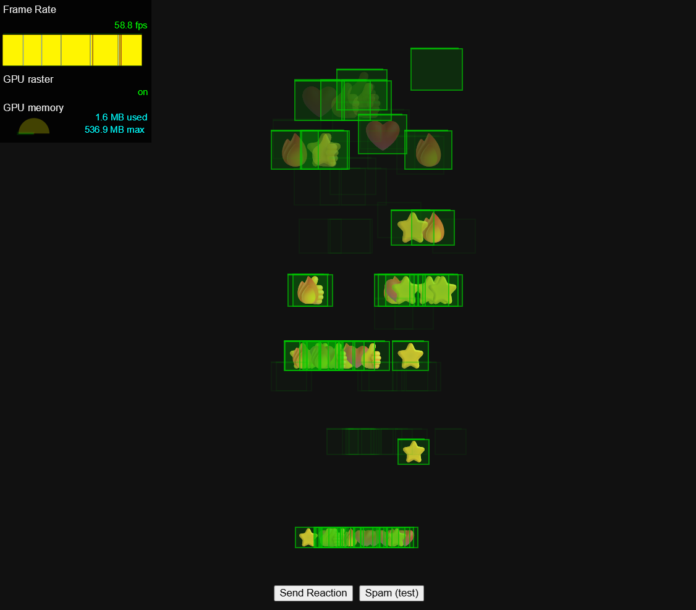
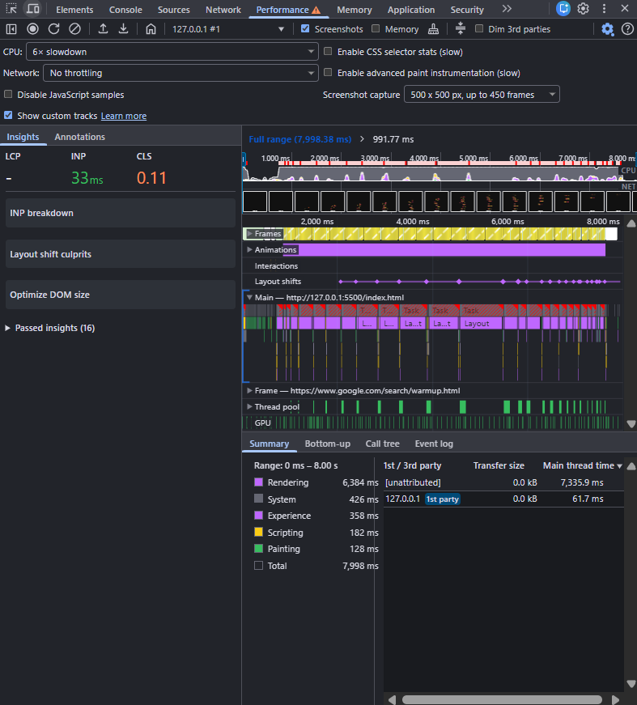
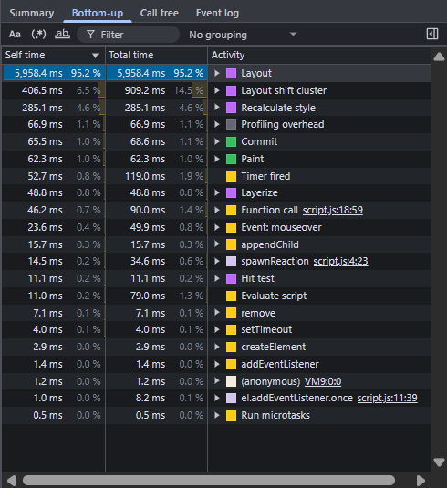
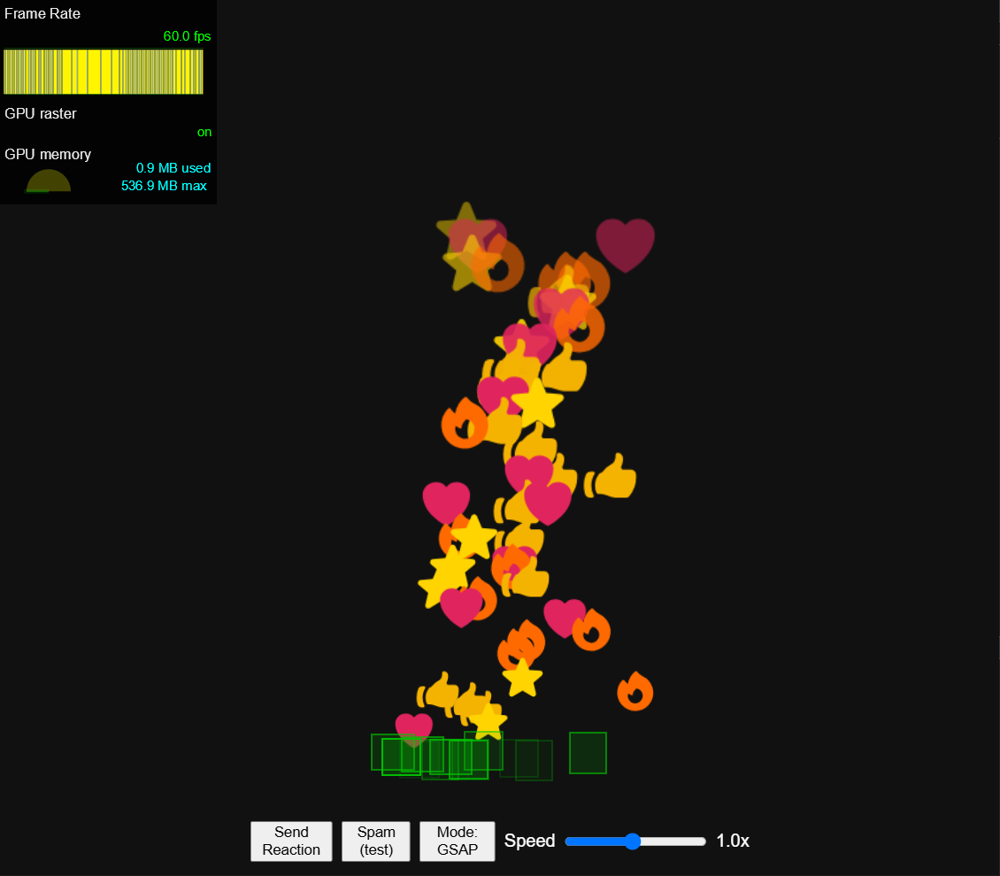
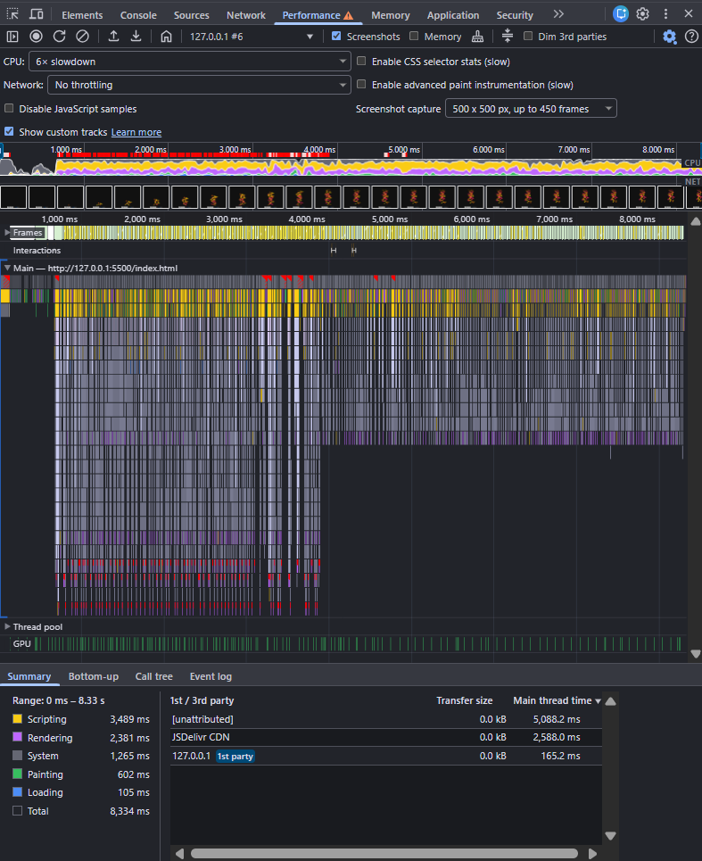

# Livestream Reaction Engine — Submission
## 1. Setup & Running Instructions
1. Clone the repo and open the folder in VS Code.
2. Right click index.html and choose **Open with Live Server** (Live Server extension required) or open it directly in Google Chrome.
3. Use buttons on the control bar at the bottom:
* **Send Reaction** spawns a singular reaction.
* **Spam (test)** spawns 60 reactions at 50ms apart, for the 50+ concurrent reaction test.
* **Mode: CSS/GSAP** toggles between Phase 1 and Phase 2.
* **Slider** adjusts playback speed of the reactions from 0.1x to 2.0x. It is disabled on the CSS mode.

**Credits:** Icons used in mode GSAP are from [Heroicons] https://heroicons.com.                             
**Note:** Phase 1 implementation uses emojis and Phase 2 uses inline SVG, so icon format differs between the two. 

## 2. Phase 1: CSS Keyframes Analysis
* **Paint Flashing Screenshot:** 

* **Performance Profile Screenshot:**                                                   

* **Observations:**
  * When paint-flashing was enabled, the green rectangles followed the entire path of each reaction from bottom to top. This caused heavy overlapping when multiple reactions were spammed. Each reaction was repainted on each frame because 'bottom', 'margin-left' and 'font-size' change geometry, invalidating layout and forcing a repaint of the affected area. 
  * Under 6x slowdown throttling animation stuttered visibly, and the frame rendering stats bar was almost entirely yellow, indicating partially presented frames. 
  * Based on the numbers provided as well as the flame chart, it showed long tasks repeating continuously and the Frames row was filled with partial frames.
  * Layout took the most time out of rendering at 5958ms, with Recalculate Style at 285ms and Paint only at 62ms. 
## 3. Phase 2: GSAP & Composited Rendering Analysis
* **Paint Flashing Screenshot:** 

* **Performance Profile Screenshot:**                                       

* **Performance Overview at 0.1x Screenshot:**                              

* **Observations:**
  * When paint-flashing was enabled, the green rectangles stayed only at the bottom of the screen, when a reaction was sent out. This is due to the 'x', 'y', 'scale', and 'opacity' being handled by the compositor. 
  * Layout time fell drastically, from 5958ms in Phase 1 to 259ms in Phase 2. Recalculate Style was higher, at 770ms, likely from creating elements via innerHTML and per-frame transform updates. Paint remained small still, at 82ms in this test. 
  * Frame rates were visibly clearer, with movements being much smoother and little to no stuttering. 
## 4. Architectural Reflection
* **Runtime Control & Developer Experience:** 
  * CSS keyframes are declarative and fixed when animation starts. Changing speed mid-flight/movement would mean rewriting the animation duration. This would likely restart the animation on the main thread. Randomizing paths are values set before animation starts. Whereas GSAP is a timeline that can be controlled while it is being run. One call retimes every live reaction, and timelines can be paused, reversed or given random values in code. 
  * The trade-off for GSAP is a JavaScript dependency and per-frame script work on the main thread, as reflected in the performance profile screenshot that shows a higher scripting time. CSS is simpler for purely static motion which has no runtime cost. However for anything that is interactive or dynamic, a programmatic approach is much easier to work with. 

* **Pipeline Considerations:** If our application needed to dynamically tint,
re-theme, or alter these reaction assets at runtime based on active user
preferences, what architectural considerations dictate choosing programmatic
vector manipulation over pre-rendered raster image sequences?
  * **Recoloring assets -** In this program's context, an inline SVG using 'fill="currentColor"' changes color with one color variable that can be updated. Raster sequences would need a separate image set for every color or theme. 
  * **Resolution quality -** SVG will stay sharp at any scale or pixel density whereas raster frames blur when upscaled.
  * **Memory and size -** One SVG can replace many frames per variant, cutting download size and number of texture held in memory. 
  * **Flexibility -** New themes or user preferences do not need to be redeployed or exported.